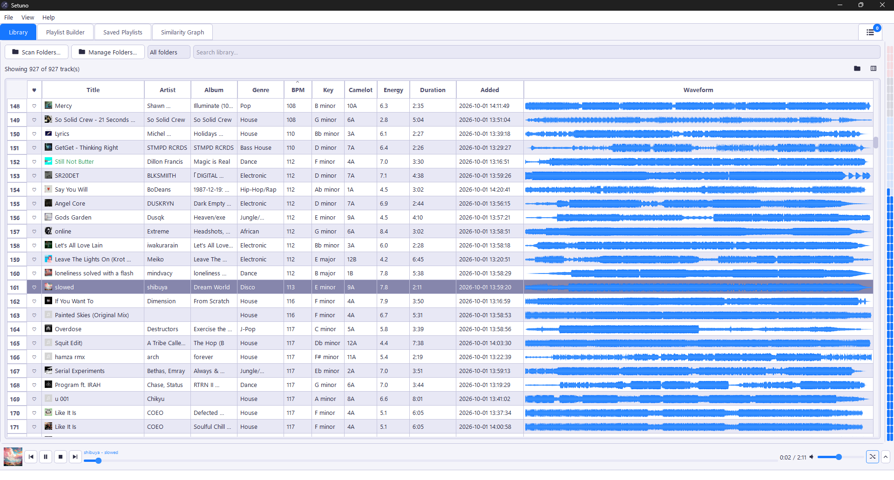
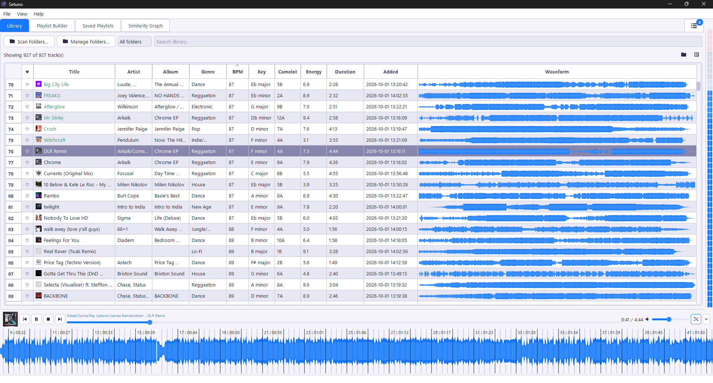
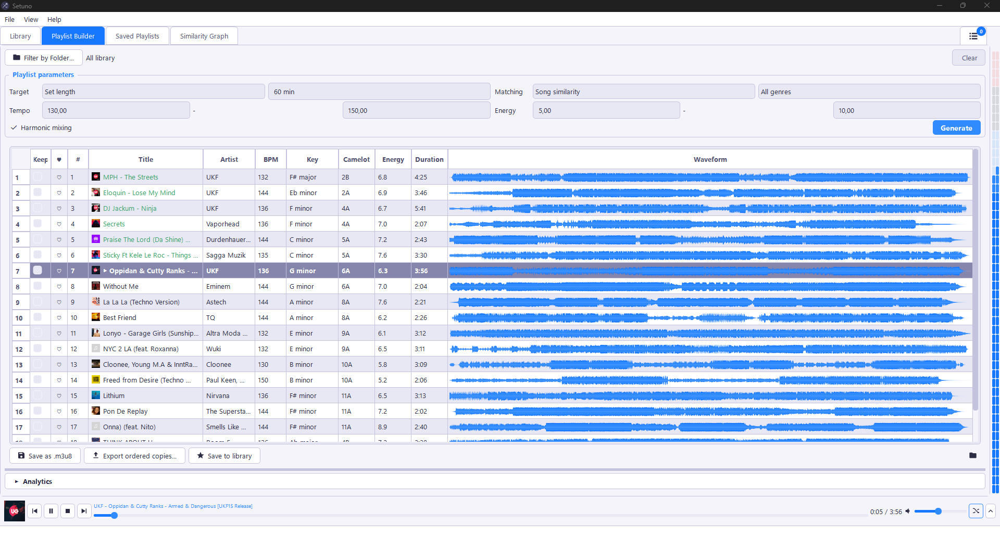
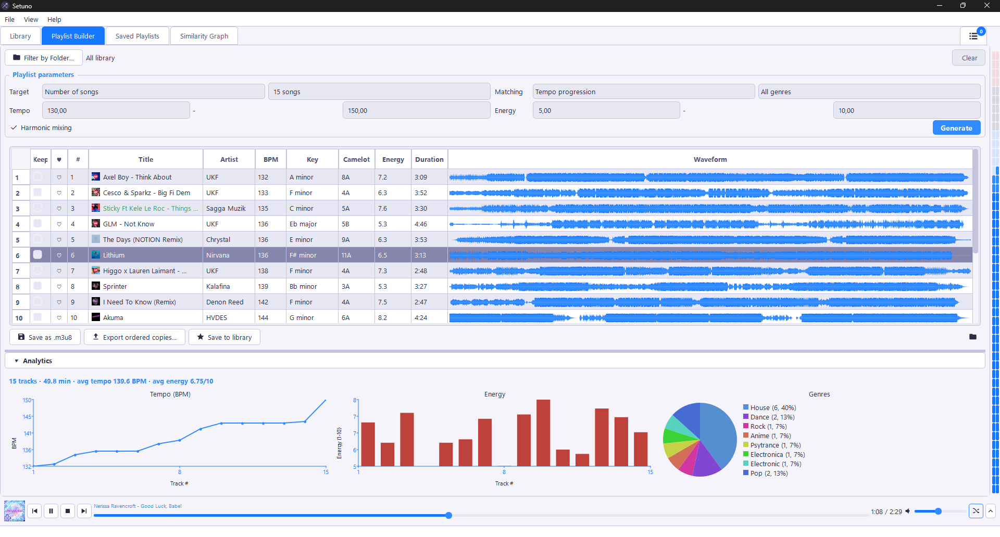
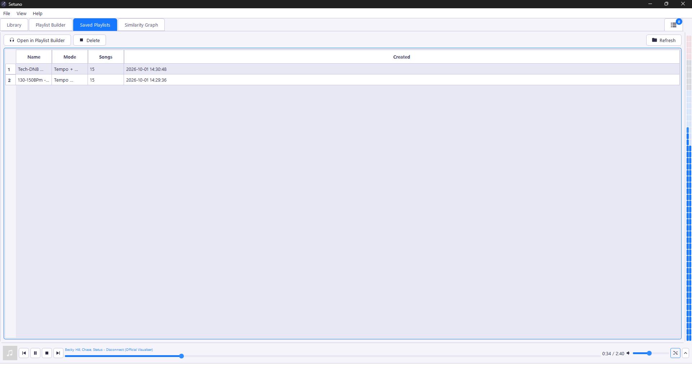
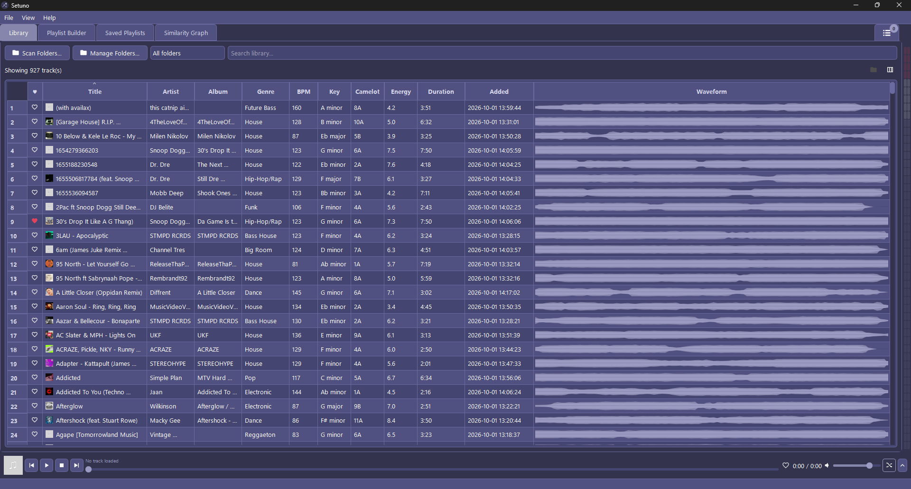
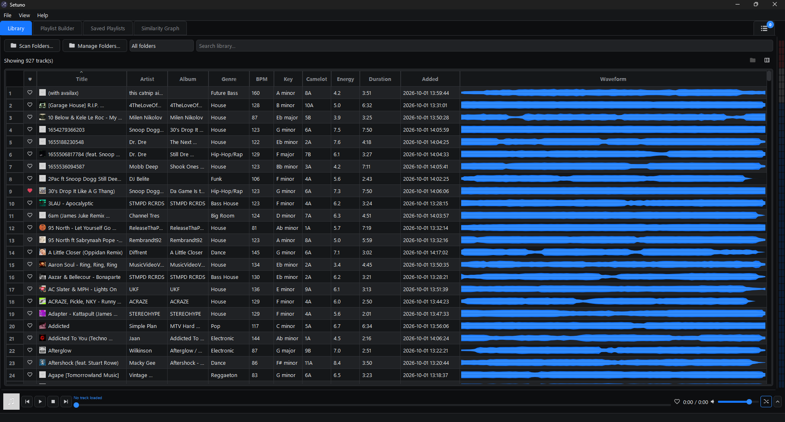

, <div align="center">
  

  # Setuno

  **A local, offline companion for DJs, radio hosts, and playlist curators.**

</div>

Setuno scans music folders (recursively), analyzes each track's **tempo (BPM)**, **musical
key** (with Camelot wheel code for harmonic mixing), **energy**, and **genre**, then generates
ordered playlists for a target set length or track count, with an embedded player, waveform
view, live statistics, and export options. Everything runs locally and offline; your library
never leaves your machine. At startup, Setuno checks GitHub for new releases when online.

Created by **J. Baudru (Bonoob)**.

Latest changes: [Setuno v1.4.0](CHANGELOG.md).

## Download

Prebuilt, ready-to-run builds are published on the [Releases page](https://github.com/jbaudru/Setuno/releases/latest):

| Platform | Download | Notes |
| --- | --- | --- |
| Windows | `Setuno-Setup-<version>.exe` | Installer (Start Menu + desktop shortcut) |
| Windows | `Setuno.exe` | Portable, no installation needed |
| macOS | `Setuno.dmg` | Open it and drag **Setuno** into **Applications** |

No Python installation is required to use these builds. If your platform isn't listed, or you'd
rather run the source directly, see [Running from source](#running-from-source) below.

## Screenshots

### Library

Browse the analyzed library, search/filter folders, spot duplicates, and open compact waveforms.



### Extended Library

Use the embedded player and expanded waveform while browsing your tracks.



### Playlist Builder

Generate a set by duration or track count, then fine-tune filters, order, and output options.



### Playlist Analytics

Inspect tempo and energy curves, genre distribution, and playlist totals.



### Saved Playlists

Browse saved playlists in list or grid view, with cover art and a small song count.
Use **Edit playlist...** to rename a playlist, choose a custom cover, or remove its cover.
Custom covers are stored locally and the selected layout is remembered between sessions.
Use the grid/list icon to switch layouts; refresh and delete are also icon-only buttons with tooltips.
Double-click a playlist to reopen it in the Playlist Builder, or select it to open or delete it.
Use **Export...** to export a saved playlist directly, without reopening the Builder.



### Themes

Choose from Setuno's dark presentation or the Rekordbox-inspired color scheme.





## Features

- Recursive folder scan (`mp3`, `wav`, `flac`, `ogg`), analyzed in parallel with a thread pool
- Automatic metadata: tempo, key (Camelot code), energy (1-10 normalized), and genre. Embedded
  genre tags and recognized genre folders take priority over matched online metadata and the
  heuristic spectral/rhythmic genre classifier. Tempo/key detection uses `librosa` when available;
  silent audio is left without a guessed BPM, key, or genre
- Timing analysis shares one high-resolution onset envelope between tempo estimators, then
  refines BPM against the full track and aligns grid phase to physical attacks. The NumPy
  fallback also uses a higher-resolution onset and fractional-lag correlation.
  Key analysis uses tuning-corrected, harmonic-separated chroma from up to three 16-second
  sections spread across the song, excluding silent/non-tonal sections. Manual BPM/key
  corrections remain authoritative, including in waveform previews.
  The grid is a constant-tempo, 4/4 estimate: half/double-tempo ambiguity, live tempo changes,
  ambiguous keys and downbeats still require listening/manual verification; this is not a
  claim of professional-software parity.
- Newly scanned tracks appear in the library when the scan finishes
- Favorites (heart a track) that are also weighted more likely to appear in generated playlists
- Playlist generation modes:
  - **Fixed tempo**: consistent tempo band, ordered for harmonic (Camelot) compatibility
  - **Tempo progression**: build up (or down) tempo across the set
  - **Fixed energy**: consistent energy band
  - **Energy progression**: energy build across the set
  - **Tempo + Energy progression**: combined build across the set
- "Keep" checkboxes in the Playlist Builder to pin favorite tracks and regenerate the rest of
  the set around them
- Add a single library track to the current Playlist Builder playlist, with Keep enabled, and
  remove duplicate songs from either the Library or playlist
- Target set length (30 min, 1h, 2h, ...) or a fixed track count, with duration-aware selection
- Filter by genre / tempo range / energy range
- Embedded audio player with click-to-seek and an extendable waveform view showing live playback
  progress, plus beat-synced auto-mix enabled by default with smooth fade and tempo curves, a
  blinking transition indicator, configurable 8-32 second transitions, and a BPM/grid match
  toggle; optional energy matching is off by default.
  BPM/grid matching uses continuous varispeed (pitch follows speed), holds the matched tempo
  through the handoff, then smoothly returns to normal over 20% of the transition duration
  (at least two seconds). The incoming deck is not stopped, reloaded, or seeked at handoff.
- Click the player track name to find it in the Library
- Per-track waveform viewer with zoom/pan, BPM grid, and independent preview playback (seek and
  play a section without disturbing the main player)
- **View > Multicolor waveforms (bass / mid / high)** toggles frequency-based colors in the
  Library, Playlist Builder, Queue, player waveform, and waveform preview windows. Colors follow
  the selected theme: highs use its main accent, with contrasting bass and mid colors.
  The main waveform silhouette always uses the theme accent; a smaller inner layer shows
  the measured frequency mix, keeping the theme dominant even on bass/mid-heavy tracks.
  The setting is remembered.
  Off uses a single theme accent.
  Newly analyzed tracks cache bass/mid/high data. For older library entries, re-analyze the
  tracks to color their mini previews; full waveforms compute this data when opened.
- Expand the player to access eight **A-H hot cues** below the waveform. Click an empty
  button to save the exact playback position; click a saved cue to jump without changing
  play/pause. Saved slots are filled with their cue color and have a small top-right **x**
  to remove the cue and free the slot. Right-click to replace or remove it. Each slot has its own color and letter
  marker in large and mini waveforms. Cues are saved per track and preserved on re-analysis.
  Cue edits are stored in a compact local `hot_cues.json` file without rewriting waveform data.
  The expanded player's beat grid labels show timecodes only (no bar numbers).
  Grid lines are spaced according to zoom: overview shows fewer bars, zooming in reveals
  individual bars and beats.
- Full metadata editor (title/artist/album/genre/cover art) from the Library or Playlist Builder
- Live stats: tempo curve, energy curve, genre breakdown, totals: themed to match the active
  color scheme
- Export: save as Rekordbox XML (playlist order, metadata, BPM and key) or `.m3u` / `.m3u8`
  (importable in Rekordbox and similar DJ software, with tags
  synced on exported copies), copy files in playlist order into a folder with numeric prefixes
  (`01 - Artist - Title.mp3`, ...), or save the playlist definition to the library
- Remove tracks from the library without touching the files on disk
- Duplicate detection for tracks with matching artist and title, including alternate file formats/bitrates
- Multiple themes (dark, light, Rekordbox-style)
- **View > Graph layout > Classical / Cluster** switches the Similarity Graph between its
  original tempo/energy positioning and separated groups of similar audio features.
  The choice is remembered. Both layouts hide axes and the separate artwork/details panel;
  track playback, hover links, tooltips and right-click queue actions remain available.
  The playing track has an enlarged green pulse and expanding halo that stays visible
  even when another track is highlighted.
- Local JSON library cache (no external database); re-scanning only re-analyzes new/changed files

## Importing playlists into Rekordbox

Choose **Export playlist...** in the Playlist Builder or **Export...** in Saved Playlists.
The default **Rekordbox XML** format includes the ordered playlist, title, artist, album,
genre, BPM, measured constant-tempo beat grid, musical key and A-H hot cues
(positions, labels and colors).
Missing audio files must be located before XML export.

1. Save the `.xml` file.
2. In Rekordbox Preferences, locate **rekordbox xml > Imported Library** (usually under
   **Advanced > Database**, or **Bridge** in older versions) and select the exported file.
3. Enable **rekordbox xml** in the browser sidebar via **Preferences > View** if hidden,
   then refresh the XML library.
4. Expand **Playlists**, right-click the exported playlist and choose **Import Playlist**.

For a simpler, order-only import, choose **M3U8** in Setuno's export dialog and use
**File > Import > Import Playlist** in Rekordbox. M3U/M3U8 does not transfer Setuno's BPM/key/hot cues.

Both formats reference audio at its current location; they do not copy audio or create a
Rekordbox USB/device library. Keep those files accessible on the importing computer.
XML exports A-H hot cues as numbered `POSITION_MARK` entries and measured grids as `TEMPO`
entries. It does not transfer variable-tempo grids, memory cues, or playlist covers.
Cue/grid import support depends on the Rekordbox version.
Rekordbox may still
analyze imported tracks or retain existing metadata for tracks already in its collection.

Format reference: [official Rekordbox XML documentation](https://rekordbox.com/en/support/developer/).

## Running from source

If you're not using one of the compiled builds above, Setuno runs anywhere Python 3.11+ and Qt
are supported (Windows, macOS, Linux).

```bash
git clone https://github.com/jbaudru/Setuno.git
cd Setuno
python -m venv .venv

# Windows
.venv\Scripts\Activate.ps1
# macOS / Linux
source .venv/bin/activate

pip install -r requirements.txt
python main.py
```

### Dependencies

Kept intentionally minimal for a small, portable build:

- `PySide6`: UI, embedded player (QtMultimedia)
- `numpy`: tempo/key/energy DSP (STFT, onset detection, autocorrelation, chroma)
- `miniaudio`: lightweight audio decoding (mp3/wav/flac/ogg)
- `mutagen`: reading and writing tags/cover art
- `librosa` *(optional)*: improves tempo and key detection accuracy when installed; Setuno
  automatically falls back to its built-in numpy-only detector if it isn't present

## Building the binaries yourself

Both the Windows `.exe`/installer and the macOS `.app`/`.dmg` are produced from the same
[`build.spec`](build.spec) PyInstaller spec, and are built automatically by the
[`release` GitHub Actions workflow](.github/workflows/release.yml) whenever a `v*` tag is pushed
(see the **Actions** tab for build artifacts, or the **Releases** page once published).

To build locally instead:

### Windows

```powershell
pip install pyinstaller
python -m PyInstaller --noconfirm build.spec
# -> dist\Setuno.exe (portable, single file)
```

`dist\Setuno.exe` is kept for release publishing; other transient build files remain ignored.
Close Setuno before replacing that executable. If it is running, build a separate copy instead:

```powershell
python -m PyInstaller --noconfirm --distpath dist\preview build.spec
# -> dist\preview\Setuno.exe
```

Optionally wrap it in a proper installer with [Inno Setup](https://jrsoftware.org/isinfo.php):

```powershell
ISCC installer\setuno.iss
# -> dist\installer\Setuno-Setup-<version>.exe
```

### macOS

```bash
pip install pyinstaller
bash scripts/make_icns.sh   # generates assets/icon.icns from icon.png (macOS only)
pyinstaller build.spec
# -> dist/Setuno.app
```

Package it as a `.dmg` for distribution:

```bash
hdiutil create -volname "Setuno" -srcfolder dist/Setuno.app -ov -format UDZO dist/Setuno.dmg
```

## Notes

- Library, playlists, settings, and covers are saved under `%LOCALAPPDATA%\Setuno\data`
  on Windows or `~/Library/Application Support/Setuno/data` on macOS. Existing files next
  to the old app are copied there on first run; the originals are kept. No external database.
- Analysis of long tracks is capped to a ~90s representative window for speed; this keeps
  scanning fast while still giving reliable tempo/key/energy estimates.
- Genre is read from existing ID3/Vorbis tags when present; otherwise it's classified by a
  nearest-profile match over BPM and spectral/rhythmic descriptors (see `GENRE_PROFILES` in
  `playlistbro/core/analyzer.py`).

## Roadmap — ideas for later

Useful DJ/radio/curator features not yet implemented, kept here as a backlog:

- **Vocal/instrumental detection** — tag tracks as vocal, instrumental, or acapella for smarter mixing.
- **Streaming service import** — import a Spotify/SoundCloud/Bandcamp playlist as a reference to match against the local library.
- **Confidence score** — show a confidence indicator alongside auto-detected BPM/key for low-certainty tracks.
- **Multiple output profiles** — export presets per target software (Rekordbox, Serato, Traktor, generic M3U) with their specific quirks/metadata.
